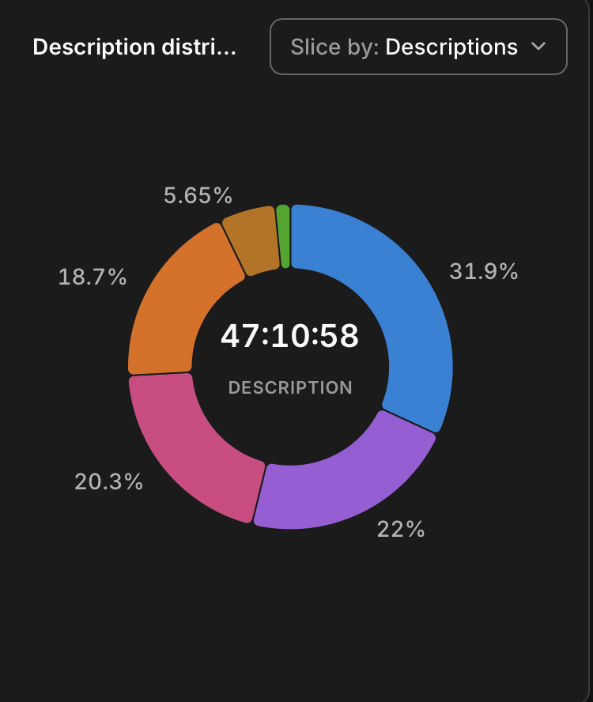

# 11-8-2026 simple ML algorithms   
  
At the end of Spring 2026, I failed a Machine Learning course. I recall submitting the first program of the semester with a bug and becoming caught between the pull of upcoming assignments and desire to complete and perfect a past assignment.  My professor empathized and shared that he once designed assignments so that the next in sequence depended on the completion of the previous.   
  
The goal of the assignment was to implement simple ML algorithms that would exemplify overfitting and underfitting as well teach us how tweak an algorithm to improve accuracy. My accuracy ratings deviated largely from expectations and it was suggested that I did not correctly load my data.   
  
I haven’t written any code for the better half of this year. I first learned the basics of Python Fall 2025. I’m not much more than a baby learning the alphabet. I utilized Toggl to log how much time each section of Program 1 of my ML course took me. I invested almost 50 hours. This horrified my professor. I should have finished the assignment in 9-12 hours.   
  
  
It’s 10:28 PM. I’m not going to be able to debug Program 1 tonight. I do have about 1 hour and a half of Data Camp’s “free access week” left. I found at the end of my Machine Learning course I could not visualize the structure of larger assignments with many moving parts. I stumbled upon UML diagrams, but was advised to learn OOP first. Let’s try this “Object-Oriented Programming in Python” course. BRB.   
  
Data Camp taught me that “the best way to learn how to write object-oriented code is to study the design of existing classes”. I was prompted to use `help()` to learn the methods and attributes of the objects within a class. Eventually, I enjoyed my experience too much and started to consider paying for a subscription.   
  
Next steps are to:  
  
1. Read my Program1.py submission   
2. Complete the first 6 exercises in this open source textbook: [https://python-textbok.readthedocs.io/en/latest/Python_Basics.html#answers-to-exercises](https://python-textbok.readthedocs.io/en/latest/Python_Basics.html#answers-to-exercises)  
3. Attempt a freecodecamp daily exercise (at least draft psuedo-code)   
  
  
Good night.  
  
  
